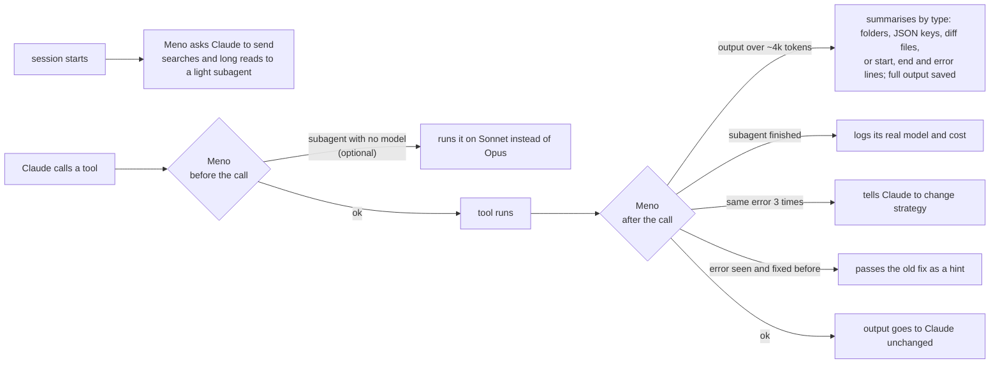

# Meno

**A Claude Code plugin that cuts token waste where it actually happens.** *Meno* is Italian for "less".

No proxy, no server, no background process. Just a few hooks and Node.js.

   

```
claude plugin marketplace add maca-codes/meno-tokens
claude plugin install meno@meno
```

Formerly **token-diet** (renamed in 0.8.2). Updating keeps your history: the report still reads the old data folder, and `~/.claude/token-diet` is moved to `~/.claude/meno` on first use.

---

## The problem

Each message you send to Claude Code carries the whole conversation with it. When a session reaches 150k tokens, you pay for those 150k tokens again on every turn.

Most of that weight is not your conversation. It is tool output: a 3,000-line log the model needed for one error, a file it read in full to change one function, the same file read a second time, a command that failed six times in a row. Once that text is in context, every later message pays for it again.

Meno stops that waste before it enters the context, and tells you when a session has grown too heavy to be worth continuing.

## How it works

Meno plugs into the Claude Code hook system. It sits between the tools and the model and only steps in when something is clearly wasteful.



Nothing is ever lost. A trimmed output is saved in full, and the model can Grep it or read any part of it.

## What it does

### While Claude works

| Feature | What happens |
|---|---|
| **Read through a subagent** | At the start of each session (and after `/clear` or compaction) Claude gets a ~70-token instruction: searches and reads of more than ~3 files go to a light subagent (Explore, or Haiku) that returns only a summary with `file:line` references. Every token read into the main context is sent again with each later message; a summary of 1-2k tokens replaces 40-60k. Claude still plans, edits and verifies itself. |
| **Output trimming** | Bash, PowerShell and Grep output over ~4k tokens is cut down, in a way that fits what it is: a file listing is summarised by folder (so nothing in the middle disappears), JSON by its structure, a diff by its files with +/- counts, anything else to the first and last lines plus every error or warning line in between. The full output is saved to a file the model can search, with secrets masked; reading it again is never trimmed. The same applies to the parts the model reads of MCP tool results, WebFetch results and subagent replies. |
| **Subagent model** (optional) | With `"agentModel": "on"`, a general-purpose subagent started without a model runs on Sonnet instead of inheriting Opus. A model chosen in the call or in an agent's definition is never changed. Off by default until your own report shows it pays off. |
| **Read guard** (optional) | With `"readGuard": true`, a whole read of a file with 800+ lines, or a re-read of an unchanged part already in context, is turned into a request to Grep or read a range first. Off by default: in real use the model repeated almost every blocked read, so the block cost a round trip and saved nothing. |
| **Loop breaker** | When a tool fails 3 times in a row with the same error, or a command keeps returning the same problem, Claude is told to stop and try another approach. You get a one-line notice. Numbers in errors are ignored, so changing line numbers or timings do not hide a loop; a clean result in between resets the count, and "0 failed" is not a problem. |
| **Error memory** | When a call fails and the same call later succeeds, the steps in between (8 at most, look-only commands like `ls` or `git status` excluded) are saved as the fix. If the same error appears again, in any project, the fix is given to Claude as a short hint (~100 tokens). Paths and numbers are masked, so the same error in another folder still matches; passwords and tokens are masked before saving. |

### For you

| Feature | What happens |
|---|---|
| **Context warnings** | You are warned at 80k, 150k, 250k and 400k tokens of context, and when a pause longer than the cache lifetime (Claude Code's own setting, otherwise 60 minutes) means the next message re-sends a big context at full price. The warnings are shown to you only, so they cost nothing. |
| **Model hint** | If the first request of an Opus session looks simple, you are told you could use Sonnet (`/model sonnet`); if the first request of a Sonnet session is clearly hard (architecture, from scratch, race conditions, a long detailed brief), you are told Opus will need fewer attempts. Shown once, at the start, because switching later reloads the whole context. |
| **Light restart** | `/meno:handoff` writes a short note on where you are. Run `/clear` and the new session loads it automatically: you continue with a few hundred tokens instead of the whole old context. |
| **Setup hygiene** | `/meno:hygiene` (runs in its own Sonnet subagent, so the files it reads stay out of your conversation) measures what every session loads before your first message (CLAUDE.md files, memory, skill descriptions, MCP servers, startup hooks) and lists the skills and servers you never used. With `analyze`, Claude proposes cuts and changes nothing until you agree. |
| **Proof** | `/meno:report` shows net tokens saved per day, loops stopped and errors recognized. Trimmed outputs the model opened again (also after `/clear` or from a subagent) are subtracted, so the number is not inflated. It also shows every subagent's real model and cost against the same tokens on the main model, and warns when Meno itself hit internal errors, so a feature that stopped working does not look like "nothing to do". |

## Plays well with others

Meno does not compete with other token savers. It works on a different layer, so it adds to what they save.

| Tool | What it does | Together with Meno |
|---|---|---|
| [RTK](https://github.com/rtk-ai/rtk) | Rewrites shell commands into compact forms before they run. | RTK shrinks the output at the source, Meno trims only what is still too long afterwards, with a double threshold for `rtk` commands so compact output is not cut twice. Savings are counted on what Meno actually receives, so nothing is counted twice. Tested side by side with no conflict. |
| Output-style skills (e.g. caveman) | Make Claude's own replies shorter. | They cut what Claude writes, Meno cuts what tools return. Different tokens, no overlap. |
| [CodeBurn](https://github.com/getagentseal/codeburn) | Measures real spend from your transcripts. | Use it to check the savings before and after installing Meno. |

Meno only adds hooks. It does not replace or disable hooks from other plugins, and it does not touch your settings files.

## Commands

| Command | Description |
|---|---|
| `/meno:report [days]` | Savings per day |
| `/meno:handoff` | Write a handoff note, then `/clear` to restart light |
| `/meno:hygiene [days]` | Measure your startup context; add `analyze` for proposed cuts |
| `/meno:errors` | List remembered errors and fixes; `delete N` removes one |

To keep a single command's output untouched, end the command with `# full`.

## Install

From GitHub:

```
claude plugin marketplace add maca-codes/meno-tokens
claude plugin install meno@meno
```

From a local folder:

```
claude plugin marketplace add ./meno-tokens
claude plugin install meno@meno
```

Restart Claude Code. It works right away; configuration is optional.

## Configure

Create `config.json` in the plugin data folder (`~/.claude/plugins/data/meno-<marketplace>/`). Set only the keys you want to change:

```json
{
  "lang": "en",
  "trimMaxChars": 16000,
  "trimHeadLines": 40,
  "trimTailLines": 30,
  "readMaxLines": 800,
  "contextWarnAt": [80000, 150000, 250000, 400000],
  "loopAfter": 3,
  "modelHint": "both",
  "delegateHint": true,
  "agentModel": "off",
  "readGuard": false,
  "hygieneExtraFiles": [],
  "neverTrim": [],
  "keepOutputsDays": 7,
  "cacheTtlMinutes": 60
}
```

`neverTrim` lists folders (`~` allowed) that are never trimmed or blocked: files there are read whole, and a shell command or Grep that mentions the folder keeps its full output. Use it for notes Claude must read in full, e.g. files loaded at every session start. Windows and Git Bash forms of the same path (`C:\...`, `/c/...`) both match.

`hygieneExtraFiles` adds files your setup reads at startup to the hygiene count.

`keepOutputsDays` sets how long saved full outputs are kept. `cacheTtlMinutes` is the prompt cache lifetime used for the pause warning when Claude Code's `CLAUDE_CODE_PROMPT_CACHE_TTL` is not set (`0` turns it off).

`modelHint`: `"both"`, `"down"` (only Opus to Sonnet) or `false`. `delegateHint: false` removes the session-start instruction. `agentModel: "on"` routes general-purpose subagents without a model to Sonnet; it only changes the model, your permission rules for Agent still apply. `readGuard: true` brings back the read guards.

## Privacy

Everything stays on your machine, never in your repository. Logs and saved outputs live in the plugin data folder (`~/.claude/plugins/data/meno-<marketplace>/`), handoff notes and the error memory in `~/.claude/meno/`. Nothing is sent anywhere. Things that look like passwords, tokens and API keys are masked before anything is saved, and saved outputs are deleted after 7 days.

## Test

```
node test/run.js
```

## License

MIT
