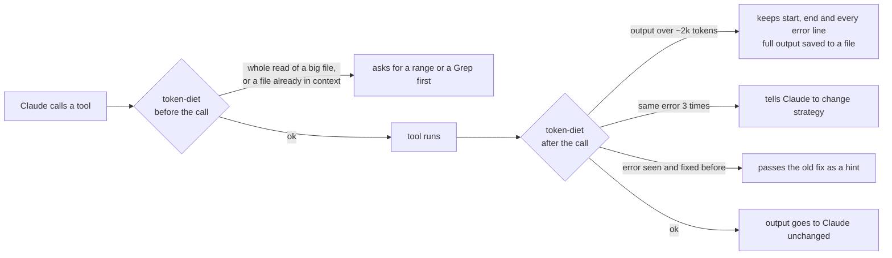

# token-diet

**A Claude Code plugin that cuts token waste where it actually happens.**

No proxy, no server, no background process. Just a few hooks and Node.js.

   

```
claude plugin marketplace add maca-codes/token-diet
claude plugin install token-diet@token-diet
```

---

## The problem

Each message you send to Claude Code carries the whole conversation with it. When a session reaches 150k tokens, you pay for those 150k tokens again on every turn.

Most of that weight is not your conversation. It is tool output: a 3,000-line log the model needed for one error, a file it read in full to change one function, the same file read a second time, a command that failed six times in a row. Once that text is in context, every later message pays for it again.

token-diet stops that waste before it enters the context, and tells you when a session has grown too heavy to be worth continuing.

## How it works

token-diet plugs into the Claude Code hook system. It sits between the tools and the model and only steps in when something is clearly wasteful.



Nothing is ever lost. A trimmed output is saved in full, and the model can Grep it or read any part of it. A blocked read is never a dead end: if the model repeats the same call, it goes through.

## What it does

### While Claude works

| Feature | What happens |
|---|---|
| **Output trimming** | Bash, PowerShell and Grep output over ~2k tokens is cut down to the first and last lines plus every error or warning line in between. The full output is saved to a file the model can search. |
| **Read guard** | A whole read of a file with 400+ lines is turned into a request to Grep or read a range first. If the model insists, the read goes through. |
| **No re-reads** | A file that is unchanged and already in context is not read again. Edits, `/clear` and compaction reset this; subagents are tracked separately. |
| **Loop breaker** | When a tool fails 3 times with the same error, or a command keeps returning the same error output, Claude is told to stop and try another approach. You get a one-line notice. Numbers in errors are ignored, so changing line numbers or timings do not hide a loop. |
| **Error memory** | When a call fails and the same call later succeeds, the steps in between (8 at most) are saved as the fix. If the same error appears again, in any project, the fix is given to Claude as a short hint (~100 tokens). Paths and numbers are masked, so the same error in another folder still matches. Entries expire after 60 days. |

### For you

| Feature | What happens |
|---|---|
| **Context warnings** | You are warned at 80k, 150k, 250k and 400k tokens of context. The warning is shown to you only, so it costs nothing. |
| **Model hint** | If the first request of an Opus session looks simple, you are told you could use Sonnet (`/model sonnet`). Shown once, at the start, because switching later reloads the whole context. |
| **Light restart** | `/token-diet:handoff` writes a short note on where you are. Run `/clear` and the new session loads it automatically: you continue with a few hundred tokens instead of the whole old context. |
| **Setup hygiene** | `/token-diet:hygiene` measures what every session loads before your first message (CLAUDE.md files, memory, skill descriptions, MCP servers, startup hooks) and lists the skills and servers you never used. With `analyze`, Claude proposes cuts and changes nothing until you agree. |
| **Proof** | `/token-diet:report` shows tokens saved per day, loops stopped and errors recognized. Reads the model insisted on are subtracted, so the number is not inflated. |

## Plays well with others

token-diet does not compete with other token savers. It works on a different layer, so it adds to what they save.

| Tool | What it does | Together with token-diet |
|---|---|---|
| [RTK](https://github.com/rtk-ai/rtk) | Rewrites shell commands into compact forms before they run. | RTK shrinks the output at the source, token-diet trims only what is still too long afterwards. Savings are counted on what token-diet actually receives, so nothing is counted twice. Tested side by side with no conflict. |
| Output-style skills (e.g. caveman) | Make Claude's own replies shorter. | They cut what Claude writes, token-diet cuts what tools return. Different tokens, no overlap. |
| [CodeBurn](https://github.com/getagentseal/codeburn) | Measures real spend from your transcripts. | Use it to check the savings before and after installing token-diet. |

token-diet only adds hooks. It does not replace or disable hooks from other plugins, and it does not touch your settings files.

## Commands

| Command | Description |
|---|---|
| `/token-diet:report [days]` | Savings per day |
| `/token-diet:handoff` | Write a handoff note, then `/clear` to restart light |
| `/token-diet:hygiene [days]` | Measure your startup context; add `analyze` for proposed cuts |
| `/token-diet:errors` | List remembered errors and fixes; `delete N` removes one |

To keep a single command's output untouched, end the command with `# full`.

## Install

From GitHub:

```
claude plugin marketplace add maca-codes/token-diet
claude plugin install token-diet@token-diet
```

From a local folder:

```
claude plugin marketplace add ./token-diet
claude plugin install token-diet@token-diet
```

Restart Claude Code. It works right away; configuration is optional.

## Configure

Create `config.json` in the plugin data folder (`~/.claude/plugins/data/token-diet-<marketplace>/`). Set only the keys you want to change:

```json
{
  "lang": "en",
  "trimMaxChars": 8000,
  "trimHeadLines": 40,
  "trimTailLines": 30,
  "readMaxLines": 400,
  "contextWarnAt": [80000, 150000, 250000, 400000],
  "loopAfter": 3,
  "modelHint": true,
  "hygieneExtraFiles": [],
  "neverTrim": []
}
```

`neverTrim` lists folders (`~` allowed) that are never trimmed or blocked: files there are read whole, and a shell command or Grep that mentions the folder keeps its full output. Use it for notes Claude must read in full, e.g. files loaded at every session start. Windows and Git Bash forms of the same path (`C:\...`, `/c/...`) both match.

`hygieneExtraFiles` adds files your setup reads at startup to the hygiene count.

## Privacy

Everything stays on your machine, never in your repository. Logs and saved outputs live in the plugin data folder (`~/.claude/plugins/data/token-diet-<marketplace>/`), handoff notes and the error memory in `~/.claude/token-diet/`. Nothing is sent anywhere.

## Test

```
node test/run.js
```

## License

MIT
